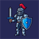

# Portfólio de Projetos & Ferramentas

Bem-vindo ao meu repositório central de projetos. Aqui você encontrará uma coleção de ferramentas de automação, aplicações web e utilitários desenvolvidos com foco em **produtividade** e **performance**.

---

  

---

###  [HelpHub (privado)](https://github.com/DreamerJP/HelpHub)

> _A plataforma definitiva para gestão de chamados e assistência técnica._

Um dos meus projetos mais robustos até o momento. Um ecossistema completo com arquitetura modular (**Application Factory**), foco extremo em segurança e uma interface **Glassmorphism** de alta fidelidade.

**Destaques de Engenharia:**

-  **Segurança Avançada:** Validação de uploads via _Magic Numbers_ e bloqueio inteligente de força bruta.
-  **Automação Inteligente:** Agendador de tarefas para backups automáticos e encerramento de chamados inativos.
-  **Analytics Premium:** Dashboard interativo com gráficos de tendência, volume por departamento e KPIs em tempo real.
-  **Business Ready:** Geração de Ordens de Serviço em PDF/A4 prontas para coleta de assinatura.

---

###  [SuporteApp Web](https://github.com/DreamerJP/SuporteApp-Web)

> _A evolução da ferramenta de auxílio ao suporte técnico._

Uma aplicação web moderna com design **Glassmorphism**, projetada para otimizar o fluxo de atendimento técnico.

**Principais Recursos:**

-  **Modo Compacto (App View):** Interface minimalista e flutuante.
-  **IP Opener:** Abertura inteligente de abas para diagnóstico de rede.
-  **PWA Ready:** Instalável como aplicativo nativo no Windows/Android.
-  **Games:** Inclui um _Snake Game_ 3D oculto/integrado.

---

###  SuporteApp Extensão (privado)

> _O SuporteApp dentro do Chrome, integrado ao OPA! Suite e ao IXC._

Versão em extensão do SuporteApp Web, com popup compacto e automações que rodam direto nas telas de atendimento do OPA! Suite e no sistema IXC.

-  **Popup Compacto:** Textos prontos copiados no formato do OPA e abertura do equipamento do cliente pelo IP.
-  **Automação no Atendimento:** Mensagens prontas, etiquetas, fluxos de incidente e comercial e alertas sonoros.
-  **O.S. em um Clique:** Abre e agenda a ordem de serviço no IXC sem sair da conversa com o cliente.
-  **Alerta de Queda:** Contador de logins offline que avisa quando uma região inteira cai.

---

###  [OLT Manager Web](https://github.com/DreamerJP/olt-command-manager-web)

> _Administração simplificada para Huawei, ZTE e Fiberhome._

Gera scripts de comando complexos automaticamente através de uma interface intuitiva. Ideal para provedores (ISPs).

**Principais Recursos:**

-  **Auto-Fill Inteligente:** Detecta Slot/Porta/Pon automaticamente.
-  **Multi-Vendor:** Suporte para as principais OLTs do mercado.
-  **Conversão em Lote:** Ferramenta poderosa para scripts em massa.

---

###  [Site Dreamer](https://github.com/DreamerJP/Dreamer)

> _Página pessoal e coleção de interesses._

Um site que criei só pra guardar e compartilhar as coisas que eu curto. É basicamente a minha coleção digital, onde junto meus hobbies e interesses pessoais e organizo tudo de um jeito bacana e interativo.

**O que tem por lá:**

-  **Filmes:** Minhas recomendações e filmes favoritos.
-  **Jogos:** Os games que mais marcaram a minha vida.
-  **Músicas:** Playlists e dicas do que eu gosto de escutar.
-  **Animes:** Uma lista com as animações que eu mais curto.
-  **Fotos:** Um espaço pra postar minhas fotos e registros pessoais.

---

###  [Downloader](https://github.com/DreamerJP/Downloader)

> _Gerenciador de downloads multithread com interface moderna e captura de vídeos._

Aplicativo para Windows feito para **saturar conexões de alta velocidade**. Divide cada arquivo em centenas de partes baixadas ao mesmo tempo, com gráfico de velocidade em tempo real e uma interface que continua leve durante o download.

-  **Paralelismo Massivo:** Até 512 conexões simultâneas por download, gravando direto no arquivo final, sem etapa de junção.
-  **Vídeos em HLS/M3U8:** Escolhe a resolução automaticamente (360p a 4K) e descriptografa streams AES-128.
-  **Extensão para Chrome:** Captura os links de vídeo durante a navegação e é instalada pelo próprio app.
-  **Atualização Automática:** O app se mantém atualizado sozinho.

---

###  [Downdetector Monitor](https://github.com/DreamerJP/DownDetectorAlert-Chrome)

> _Monitoramento de serviços e alertas em tempo real direto no navegador._

Uma extensão proativa que monitora o status de múltiplos provedores e serviços web através do Downdetector. Ela atua de forma invisível em background, notificando imediatamente o usuário quando um volume anormal de falhas é detectado.

-  **Background Tracking:** Checagens invisíveis periódicas via Service Worker para detecção rápida de incidentes.
-  **Limites Customizados:** Definição manual de limites (thresholds) de alerta para cada serviço monitorado.
-  **Alertas Push:** Envio de notificações nativas assim que os reports ultrapassam a marca de risco.

---

###  DreamerTV (privado)

> _Aplicativo pessoal de IPTV para TV Box, TVs Samsung e navegador._

Canais ao vivo, filmes e séries de uma lista M3U, com sinopses e trailers vindos do TMDB, em três versões que compartilham a mesma experiência.

-  **Três Plataformas:** Android TV em Kotlin, TVs Samsung com Tizen (que não instalam APK) e versão web.
-  **Catálogo Completo:** Canais ao vivo, filmes e séries organizados a partir da lista do provedor.
-  **Sinopses e Trailers:** Informações de cada título buscadas no TMDB.
-  **Dreamer Indica:** Uma seleção pessoal de recomendações dentro do app.

---

###  [SetupHub](https://github.com/DreamerJP/SetupHub)

> _Central de controle do PC em um único aplicativo._

Aplicação para Windows x64 que junta em um só lugar os ajustes que normalmente ficam espalhados em vários programas de fabricante.

-  **Ventoinhas e Iluminação:** Controle de rotação e de luzes do gabinete.
-  **Processador e Placa de Vídeo:** Ajustes de desempenho direto pelo app.
-  **Telas, Energia e Perfis:** Configurações salvas em perfis para trocar tudo de uma vez.
-  **Instalador Próprio:** Instala e atualiza sem interação, já abrindo o SetupHub no fim.

---

###  [Ginásio de Mesa](https://github.com/DreamerJP/GinasioDeMesa)

> _Ranking mensal das partidas de jogos de mesa do grupo._

Site com visual em pixel art onde cada partida jogada pelo grupo entra num ranking que fecha todo mês. Pode ser acessado em [dreamerjp.github.io/GinasioDeMesa](https://dreamerjp.github.io/GinasioDeMesa/).

-  **Ranking Mensal:** Cada partida rende uma nota de 0 a 1, e o mês fecha com os campeões.
-  **Duelos:** Desafios entre dois jogadores, com resultado fora do ranking.
-  **Insígnias e Títulos:** Conquistas que acompanham o perfil de cada jogador.
-  **Login com Google:** Contas e partidas guardadas no Firebase.

