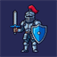

# DreamerJP

Sistemas e ferramentas para provedores de internet, aplicativos para TV, Windows e web.

### Sistemas

<table>
<tr>
<td width="50%" valign="top">

 <b>HelpHub</b> 
Gestão para provedores de internet e assistências técnicas: chamados, incidentes de rede, agenda, app do técnico de campo, clientes e contratos, OLTs e MikroTik com bloqueio de inadimplente e financeiro ligado aos meios de pagamento. Cada empresa roda numa instância isolada. 
Python · Flask · MySQL · Alpine.js · 1163 testes automatizados
</td>
<td width="50%" valign="top">

 <b>Nova Partida</b> 
Loja online de jogos de tabuleiro: vitrine com filtros, busca que tolera erro de digitação, pagamento pelo Mercado Pago, frete pelo Melhor Envio e painel de pedidos, estoque e atendimento que funciona no celular. 
Python · Django · PostgreSQL
</td>
</tr>
</table>

### Ferramentas para provedores

<table>
<tr>
<td width="50%" valign="top">

 <a href="https://github.com/DreamerJP/SuporteApp-Web"><b>SuporteApp Web</b></a> 
Textos prontos e atalhos para o atendimento de suporte técnico, com abertura do equipamento do cliente pelo IP. Instala como aplicativo no Windows e no Android. 
JavaScript · PWA
</td>
<td width="50%" valign="top">

 <b>SuporteApp Extensão</b> 
O SuporteApp dentro do Chrome, com automações no OPA! Suite e no IXC: mensagens prontas, ordem de serviço aberta e agendada sem sair da conversa e aviso quando uma região inteira cai. 
JavaScript · Extensão do Chrome
</td>
</tr>
<tr>
<td width="50%" valign="top">

 <a href="https://github.com/DreamerJP/olt-command-manager-web"><b>OLT Manager Web</b></a> 
Monta os comandos de OLTs Huawei, ZTE e Fiberhome a partir de um formulário, com conversão em lote e assistente de ativação de ONU. 
JavaScript · PWA
</td>
<td width="50%" valign="top">
 <a href="https://github.com/DreamerJP/DownDetectorAlert-Chrome"><b>Downdetector Monitor</b></a> 
Acompanha serviços no Downdetector e avisa quando as reclamações passam do limite definido para cada um. 
JavaScript · Extensão do Chrome
</td>
</tr>
</table>

### Aplicativos

<table>
<tr>
<td width="50%" valign="top">

 <b>DreamerTV</b> 
Player de canais ao vivo, filmes e séries a partir da lista M3U do provedor, com sinopses e trailers do TMDB, favoritos e continuar assistindo. 
Android TV (Kotlin) · Samsung Tizen · Roku (BrightScript) · Navegador
</td>
<td width="50%" valign="top">
 <a href="https://github.com/DreamerJP/SetupHub"><b>SetupHub</b></a> 
Ventoinhas, iluminação, processador, placa de vídeo, telas e energia do PC num app só, com perfis e instalador próprio. 
C# · .NET 10 · Windows
</td>
</tr>
<tr>
<td width="50%" valign="top">
 <a href="https://github.com/DreamerJP/Downloader"><b>Downloader</b></a> 
Acelerador de downloads com até 512 conexões por arquivo, vídeos HLS/M3U8 com escolha de resolução e extensão do Chrome que captura os links. 
Python · PyQt6 · Windows
</td>
<td width="50%" valign="top"></td>
</tr>
</table>

### Pessoais

<table>
<tr>
<td width="50%" valign="top">

 <a href="https://github.com/DreamerJP/GinasioDeMesa"><b>Ginásio de Mesa</b></a> 
Ranking mensal das partidas de jogos de mesa do grupo, com duelos e insígnias, em pixel art. 
JavaScript · Firebase
</td>
<td width="50%" valign="top">

 <a href="https://github.com/DreamerJP/Dreamer"><b>Site Dreamer</b></a> 
Minha coleção de filmes, jogos, músicas, animes e fotos. 
HTML · CSS
</td>
</tr>
</table>
